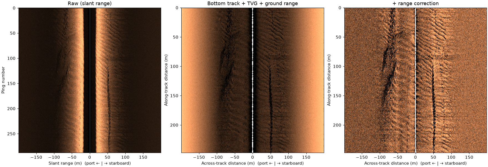
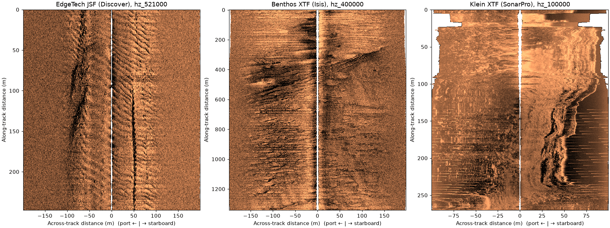

# sidescanpy

[](https://doi.org/10.5281/zenodo.24121873)

Read, correct, grid and export sidescan sonar data.

**Documentation:** <https://rshomberg-research.github.io/sidescanpy/>

> **Beta.** Until 1.0, any 0.x release may change the `.ss.h5` file
> format, the API and the CLI. Keep your raw sonar files, pin the version
> you use, and expect to re-convert `.ss.h5` files after an upgrade. See
> [`docs/status.md`](docs/status.md).



*A public EdgeTech recording (UK JNCC, Open Government Licence), raw on
the left and after the bottom-track, TVG and slant-to-ground-range steps
on the right.*

sidescanpy converts EdgeTech JSF, Klein SDF and XTF surveys into one
`xarray`-based model, stored as a grouped HDF5 file (`.ss.h5`). On top of
that model it provides:

- **Corrections:** time-varying gain (spreading + Francois-Garrison
  absorption), slant-to-ground range, per-sample georeferencing, far-range
  noise cropping. Every applied step is recorded with its parameters, and
  radiometric steps can be inverted.
- **Slicing** by ping, time, sample, slant or ground range, and bounding box.
- **Gridding** onto geographic or UTM rasters (mean, median, max, nearest,
  IDW), with GeoTIFF output.
- **Targets and datasets:** read target catalogs, match targets to pings,
  and build COCO/YOLO training sets of fixed-size chips or full swaths, in
  native pixels or real-world meters.
- **Analysis:** small functions that measure a dataset (nadir and first
  bottom return, usable range, TVG model fit, units, beam geometry,
  navigation segments) and return dataclasses.
- **CLI:** `sidescan-convert`, `sidescan-correct`, `sidescan-export`,
  `sidescan-analyze` for quick runs over the same API.

Workflows, multi-step reports and figure layouts live in your own
project scripts and in [`examples/`](examples/), not in the library.
[`examples/project_template/`](examples/project_template/) is a starting
point: one script per step, one config per survey, a report after each
step (see [`docs/workflow.md`](docs/workflow.md)).

## Install

Python 3.12 or newer. sidescanpy is not on PyPI yet; install it from
this repository, pinned to a release tag:

```bash
pip install "sidescanpy[viz] @ git+https://github.com/rshomberg-research/sidescanpy.git@v0.10.0"
pip install "sidescanpy[viz,maps,geo] @ git+https://github.com/rshomberg-research/sidescanpy.git@v0.10.0"
```

`uv pip install` and `uv add` take the same argument. The second line adds basemaps
(cartopy) and GeoTIFF output (rioxarray).

From a checkout, with [uv](https://docs.astral.sh/uv/):

```bash
uv sync --all-extras
```

| Extra | Adds | Needed for |
|---|---|---|
| `viz` | matplotlib | `sidescanpy.viz`, figures from `sidescan-export` / `sidescan-analyze` |
| `maps` | cartopy | land and locator basemaps behind georeferenced plots |
| `geo` | rioxarray | `grids.to_geotiff`, `sidescan-export grid --geotiff` |
| `dev` | pytest, ruff, matplotlib | running the tests and linters |

Conversion, correction, gridding, analysis and dataset export run without
any extra.

## Data model

Backscatter is three-dimensional: `(ping, channel, sample)`, with
`channel=0` port and `channel=1` starboard. Each frequency of a survey is
its own `xr.Dataset`; a `SideScanSurvey` holds the frequencies plus the
navigation, attitude, DVL and sensor streams. Across-track coordinates are
negative to port and positive to starboard.

## Quickstart

```python
from pathlib import Path

from sidescanpy.grids import grid_channel, to_geotiff
from sidescanpy.io import read_and_convert
from sidescanpy.io.hdf5 import read_survey, write_survey
from sidescanpy.processing import (
    apply_tvg,
    compute_geometric_ranges,
    compute_georeferencing,
    interpolate_aux_onto_pings,
    slice_by_range,
)

# Convert raw files to one .ss.h5 survey.
survey = read_and_convert([Path("line_001.jsf")], fmt="jsf")
write_survey(survey, "line_001.ss.h5")

# Each correction is one call, recorded in processing_history.
survey = interpolate_aux_onto_pings(read_survey("line_001.ss.h5"))
survey = apply_tvg(survey, spreading_loss_db=30)
survey = compute_geometric_ranges(survey)
survey = compute_georeferencing(survey)
write_survey(survey, "line_001.corrected.ss.h5", overwrite=True)

# Keep 5-60 m of slant range on one frequency and grid it at 0.5 m.
freq = sorted(survey.frequencies)[0]
ds = slice_by_range(survey.get_frequency(freq).dataset, min_m=5, max_m=60)
raster = grid_channel(ds, resolution_m=0.5)
to_geotiff(raster, "line_001.tif")  # needs the [geo] extra
```

Every correction also works on a single frequency dataset. To run them
from a config file, `processing.correct_survey(survey, steps, params)`
takes the same corrections as a list of step names; for files too large
for memory, `processing.correct_file(path, steps, chunk_pings=2000)`
corrects in place, chunk by chunk.

### Training dataset from a target catalog

```python
from sidescanpy.export.ml import DatasetSpec, build_target_dataset
from sidescanpy.io import read_target_catalog

# A directory holding the catalog: EdgeTech *.target or Klein Target_*.tgt.
# Klein targets need positions resolved first (sidescanpy.targets.correlate).
_fmt, targets = read_target_catalog("raw/")
spec = DatasetSpec(
    styles=["chip", "dual-swath"], render_level="geometric",
    size_px=1024, swath_size_px=1024, resolution_m=[30 / 1024],
    n_augment=4, jitter_px=460, random_flip=True, swath_fill=True,
    n_background=10, val_fraction=0.2, layout="ultralytics", seed=1,
)
result = build_target_dataset("corrected_ss_h5/", targets, spec, "dataset/")
```

`DatasetSpec` round-trips to YAML (`DatasetSpec.from_yaml`), so a project
keeps one config file per dataset.

## Command line

| Command | What it does |
|---|---|
| `sidescan-convert survey` | JSF/SDF/XTF files to `.ss.h5` |
| `sidescan-convert targets` | read a target catalog to `targets.json`/`.csv` |
| `sidescan-correct` | apply correction steps to `.ss.h5` files in place |
| `sidescan-export waterfall` / `grid` / `track` | images and rasters |
| `sidescan-export chip` | COCO/YOLO dataset from a target catalog |
| `sidescan-analyze investigate` | run every analysis on a file and write a report |
| `sidescan-analyze tvg-fit` / `nadir` / `usable-range` / ... | one analysis at a time |
| `sidescan-analyze segment` | split a long file into clean sections |
| `sidescan-analyze recommend-config` | suggest correction and export settings |

Every subcommand takes `--config file.yaml` with the same keys as its
flags; unknown keys warn (`--strict-config` makes them errors). Run any
command with `--help` for its options.

## Examples

The [documentation site](https://rshomberg-research.github.io/sidescanpy/examples/)
has worked examples on openly licensed public recordings, each with its
code and the figure it makes. The scripts are in
[`examples/gallery/`](examples/gallery/); `sidescanpy.datasets.fetch()`
downloads the data they use.



*Three sonars and writers read and TVG-corrected with the same calls:
EdgeTech JSF, Benthos XTF (UK JNCC, Open Government Licence) and Klein
XTF (USGS, public domain).*

[`examples/`](examples/) also holds runnable scripts, each smoke-tested on
synthetic data: `project_template/` (a full per-step workflow), `quickstart.py`, `tvg_calibration.py`,
`gridding_and_geotiff.py`, `build_yolo_dataset.py`,
`investigate_dataset.py`, and figure recipes in `examples/figures/`.

## Logging

The library logs only at DEBUG and WARNING and never configures handlers.
Call `sidescanpy.log.configure_logging("INFO")` in a script, or pass
`-v` / `-q` / `--log-file` to any CLI command.

## Documentation

<https://rshomberg-research.github.io/sidescanpy/>: guide, worked
examples and API reference. The site is public; the repository is not
yet.

## Development

```bash
uv sync --all-extras
make test   # unit tests (clears PYTHONPATH)
make lint   # ruff
make docs   # documentation site, runs the gallery (needs every extra: uv sync --all-extras)
```

Integration tests under `tests/integration/` need real survey files and
are skipped without them. The public test fixtures are not in the
repository either; see [`docs/development.md`](docs/development.md#test-data). See [`docs/development.md`](docs/development.md)
and [`CHANGELOG.md`](CHANGELOG.md).

## Citing

If you use sidescanpy in your work, please cite it. The concept DOI
[10.5281/zenodo.24121873](https://doi.org/10.5281/zenodo.24121873) always resolves to the latest release;
each release also has its own version DOI on Zenodo, which pins the exact
code you used. `CITATION.cff` holds the citation in machine-readable form
(GitHub's "Cite this repository" button reads it).

> Shomberg, R. sidescanpy: read, correct, grid and export sidescan sonar
> data. Zenodo. https://doi.org/10.5281/zenodo.24121873

## License

MIT. See [`LICENSE`](LICENSE).
