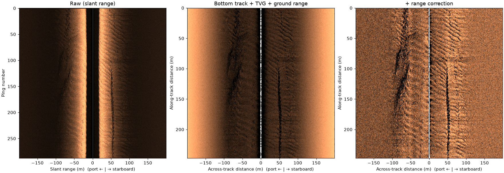

# Correct a line

`correct_survey` applies an ordered list of correction steps. Each step
is optional, can be replaced by your own function, and is recorded with
its parameters in the dataset's `processing_history`, so a corrected
file says how it was made.

This JNCC line records no altitude above the seabed, which the
slant-to-ground-range step needs. The `bottom_track` step picks it from
the first seabed return in each ping (17.5 m here) before `geometric`
runs.



Left: raw amplitude against slant range. Middle: after the bottom track,
time-varying gain (TVG, spreading and absorption losses) and
slant-to-ground range, in dB against across-track and along-track
distance in metres; the water column is gone. Right: TVG leaves this
line brighter at far range than near the towfish. `fit_range_correction`
measures that leftover trend from the line itself, and the
`range_correction` step removes it, which brings out the regular bedforms on
both sides and the ridges port and starboard.

After TVG, `backscatter_intensity` is in dB, so it is plotted as is. The
JSF holds about 23,000 samples per side; averaging them down to about
1000 for display (`xarray`'s `coarsen`) shows the seabed instead of the
speckle.

```python
--8<-- "examples/gallery/correct_a_line.py"
```

The default TVG uses 30 log R spreading and Francois-Garrison
absorption. Whether a sonar already applied some gain in hardware varies;
`analysis.fit_range_decay` measures what a dataset still needs (see
`examples/tvg_calibration.py`).

Data: JNCC Wight-Barfleur Reef, Open Government Licence v3.0 (see
[the example data](index.md#sources-and-licences)).
