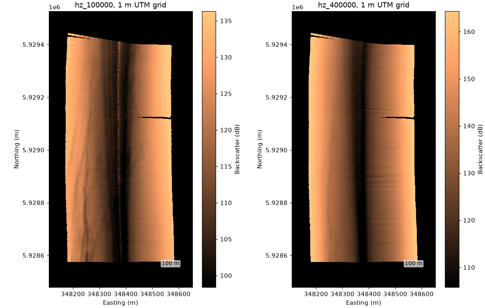

# Grid to a map

Once every sample has a latitude and longitude (the `georef` step),
`grid_channel` resamples a channel onto a regular UTM grid and
`to_geotiff` writes it for a GIS.



One line of a Benthos SIS-1624 survey in the Irish Sea, 100 kHz and
400 kHz, on 1 m grids. North is up; the dark stripe is the nadir under
the towfish.

```python
--8<-- "examples/gallery/grid_to_a_map.py"
```

Navigation in this file is sample-and-hold: each position repeats for
several pings until the next fix arrives. The `interpolate_aux` step
interpolates between the real fixes, not the repeated entries, which
puts the pings about 0.65 m apart. The GeoTIFF needs the `geo` extra
(`rioxarray`).

Data: JNCC mid-Irish Sea, Open Government Licence v3.0 (see
[the example data](index.md#sources-and-licences)).
