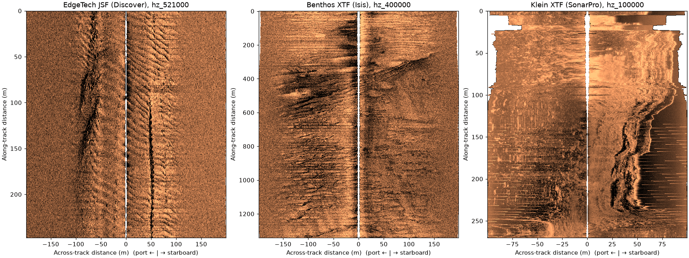

# Examples

Each example runs sidescanpy on a real, openly licensed recording that
anyone can download, and shows the code and the image it makes. The code
on each page is the script in `examples/gallery/`, included as is.

| Example | What it shows | Data |
|---|---|---|
| [Read a file](read_a_file.md) | Convert a raw JSF file, save `.ss.h5`, plot the waterfall | JNCC Wight-Barfleur, EdgeTech |
| [Correct a line](correct_a_line.md) | Altitude from the bottom track, TVG, ground range, range correction | JNCC Wight-Barfleur, EdgeTech |
| [Grid to a map](grid_to_a_map.md) | Range correction, gridding to UTM, GeoTIFF output | JNCC mid-Irish Sea, Benthos |
| [Three formats, one model](three_formats.md) | The same calls on EdgeTech JSF, Benthos XTF and Klein XTF | JNCC and USGS |

[](three_formats.md)

## Running them

```bash
python examples/gallery/correct_a_line.py out/
```

Each script writes its figure to the directory you give it (the current
one by default). `make gallery` runs them all and refreshes the images
on these pages. Plotting needs the `viz` extra and the GeoTIFF in
[Grid to a map](grid_to_a_map.md) the `geo` extra.

## The example data

`sidescanpy.datasets.fetch(name)` returns a local path to a recording,
downloading it the first time. Each recording is one file inside a large
public agency archive (8 to 57 GB); `fetch` reads just that file out of
the archive with HTTP range requests, checks its SHA-256 and caches it.

```python
from sidescanpy import datasets

datasets.list_datasets()          # the names fetch() accepts
path = datasets.fetch("usgs_grand_bay_150602205800.xtf")
print(datasets.citation("usgs_grand_bay_150602205800.xtf"))
```

Files are cached in `~/.cache/sidescanpy`, or in `SIDESCANPY_DATA_DIR`
when set. A file already there with the right checksum is used without
going online.

| Name | Size | Recording |
|---|---|---|
| `jncc_wight_barfleur_20130321174522.jsf` | 40 MB | EdgeTech JSF (Discover), 219 + 521 kHz, no recorded altitude |
| `jncc_wight_barfleur_20130321174522H.xtf` | 27 MB | The same pings, high frequency, as XTF (Discover 7.22) |
| `jncc_wight_barfleur_20130321174522L.xtf` | 13 MB | The same pings, low frequency, as XTF (Discover 7.22) |
| `jncc_mid_irish_sea_MIS11_0.xtf` | 41 MB | Benthos SIS-1624, XTF (Isis 7.0.41), 100 + 400 kHz |
| `jncc_mid_irish_sea_MIS13_2.xtf` | 4 MB | The same sonar, a short line |
| `jncc_mid_irish_sea_MIS15_2.xtf` | 54 MB | The same sonar, 100 + 400 kHz, over bedforms |
| `usgs_grand_bay_150602205800.xtf` | 5 MB | Klein, XTF (KleinXlt 4.0 / SonarPro 12), shallow estuary |
| `usgs_grand_bay_150531200100.xtf` | 12 MB | Klein, XTF; the recorded altitude is a lost bottom track |
| `usgs_grand_bay_150602133300.xtf` | 16 MB | Klein, XTF (SonarPro), a sharp seabed edge; recorded altitude unusable |

## Sources and licences

- **Wight-Barfleur Reef.** Joint Nature Conservation Committee, *Raw side
  scan sonar data from Wight-Barfleur Reef SCI* (CEND 03/13, 2013),
  <https://www.data.gov.uk/dataset/5298a3dd-af03-4509-b806-ab9f884816ae>.
  Contains public sector information licensed under the
  [Open Government Licence v3.0](https://www.nationalarchives.gov.uk/doc/open-government-licence/version/3/).
- **Mid-Irish Sea.** Joint Nature Conservation Committee, *Raw sidescan
  sonar data from Submarine structures in the mid-Irish Sea Area of
  Search* (CEND 11/08, 2008),
  <https://www.data.gov.uk/dataset/4a67eeb2-3dce-40b6-96ca-66cc25eeeada>.
  Contains public sector information licensed under the Open Government
  Licence v3.0.
- **Grand Bay.** Locker, S.D., Forde, A.S., and Smith, C.G., 2018,
  *Subbottom and Sidescan Sonar Data Acquired in 2015 From Grand Bay,
  Mississippi and Alabama*: U.S. Geological Survey data release,
  <https://doi.org/10.5066/P9374DKQ>. Public domain; the U.S. Geological
  Survey is the originator of the data.

The figures on these pages are derived from those recordings under the
same terms.
