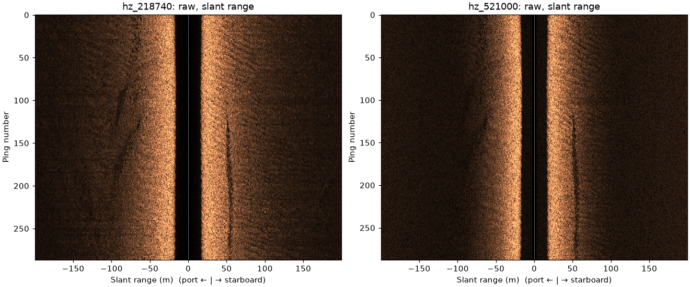

# Read a file

Convert one raw EdgeTech JSF line to sidescanpy's data model, save it as
`.ss.h5`, and look at it. `read_and_convert` reads JSF, Klein SDF and XTF
into the same structure: a `SideScanSurvey` holding one `xarray.Dataset`
per frequency, with backscatter shaped `(ping, channel, sample)`
(channel 0 is port, 1 starboard) plus the navigation and attitude
records.



The two frequencies of the same 288 pings, raw amplitude against slant
range. The dark band in the middle is the water column under the towfish;
the seabed starts where it ends, about 18 m out on each side. A linear
seabed feature runs along the starboard side at about 50 m.

```python
--8<-- "examples/gallery/read_a_file.py"
```

It prints the size of each frequency:

```
hz_218740 {'ping': 287, 'channel': 2, 'sample': 11568}
hz_521000 {'ping': 288, 'channel': 2, 'sample': 23140}
```

The reader also logs two warnings worth knowing about: this file records
no sound velocity (1500 m/s is used) and no altitude.
[Correct a line](correct_a_line.md) fills the altitude in.

Data: JNCC Wight-Barfleur Reef, Open Government Licence v3.0 (see
[the example data](index.md#sources-and-licences)).
