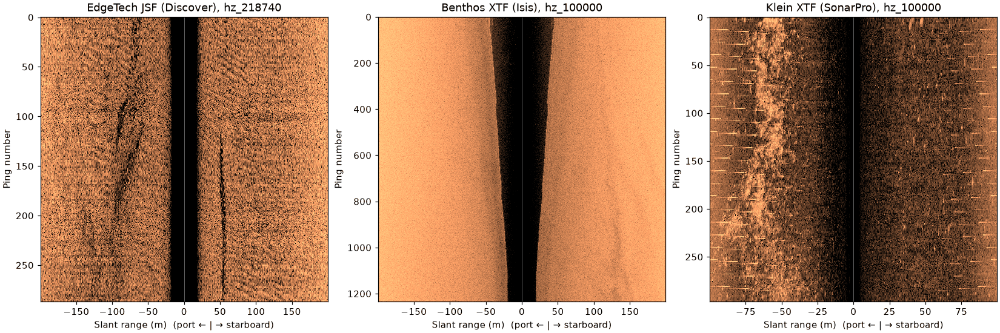

# Three formats, one model

Three sonars, three file formats or writers, the same code. Each line is
read with `read_and_convert`, TVG-corrected with `correct_survey` and
plotted with `plot_waterfall`; only the file name and format string
change.



From left: EdgeTech (JSF written by Discover), Benthos SIS-1624 (XTF
written by Isis) and Klein (XTF written by SonarPro), each in dB against
slant range.

```python
--8<-- "examples/gallery/three_formats.py"
```

The last part reads the same EdgeTech pings twice: Discover wrote the
line both as JSF and as XTF. The two readers return identical samples:

```
JSF vs XTF, 288 pings: max |difference| = 0
```

Data: JNCC Wight-Barfleur Reef and mid-Irish Sea (Open Government Licence
v3.0) and USGS Grand Bay (U.S. public domain); see
[the example data](index.md#sources-and-licences).
