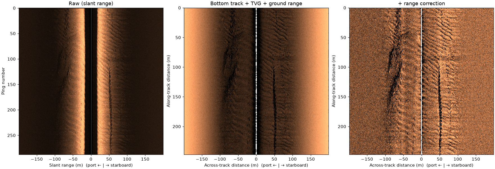

# sidescanpy

Read, correct, grid and export sidescan sonar data.

sidescanpy converts EdgeTech JSF, Klein SDF and XTF surveys into one
`xarray`-based model stored as `.ss.h5`, then corrects it (TVG, ground
range, georeferencing), slices it, grids it to rasters and GeoTIFF, and
builds COCO/YOLO training datasets from target catalogs. Small analysis
functions measure a dataset's units, nadir, usable range and TVG state.

:::{admonition} Beta
:class: warning
Until 1.0, any 0.x release may change the `.ss.h5` file format, the
API and the CLI. Keep your raw sonar files, pin the version you use,
and expect to re-convert `.ss.h5` files after an upgrade. See
[Stability](status.md).
:::

[](examples/plot_correct_a_line.rst)

*A public EdgeTech recording, raw (left) and after the bottom track, TVG
and slant-to-ground-range steps (right). Code and data:
[Correct a line](examples/plot_correct_a_line.rst).*

## Quickstart

```python
from sidescanpy import datasets
from sidescanpy.grids import grid_channel, to_geotiff
from sidescanpy.io import read_and_convert
from sidescanpy.io.hdf5 import write_survey
from sidescanpy.processing import (
    apply_tvg,
    compute_geometric_ranges,
    compute_georeferencing,
    interpolate_aux_onto_pings,
)

# A public Benthos XTF line; any JSF, SDF or XTF path works the same way.
path = datasets.fetch("jncc_mid_irish_sea_MIS11_0.xtf")
survey = read_and_convert([path], fmt="xtf")

survey = interpolate_aux_onto_pings(survey)   # navigation onto the pings
survey = apply_tvg(survey)                    # time-varying gain
survey = compute_geometric_ranges(survey)     # slant to ground range
survey = compute_georeferencing(survey)       # latitude and longitude per sample
write_survey(survey, "MIS11_0.ss.h5")

# Grid one frequency at 1 m and write a GeoTIFF (needs the geo extra).
raster = grid_channel(survey.get_frequency("hz_400000").dataset, resolution_m=1.0)
to_geotiff(raster, "MIS11_0_400khz.tif")
```

[Install](install.md) covers the install and its extras. [Getting started](getting_started.md)
walks through this code step by step, with the output of each step.

## Citing

If you use sidescanpy in your work, please cite it:
Shomberg, R. *sidescanpy: read, correct, grid and export sidescan sonar data*.
Zenodo. [doi:10.5281/zenodo.24121873](https://doi.org/10.5281/zenodo.24121873). This concept DOI always resolves
to the latest release; each release on Zenodo also has its own version DOI.

## Where to go next

- **Start here:** [Install](install.md), [Getting started](getting_started.md).
- **Examples:** [real data, code and results](examples/index.rst), all on
  openly licensed recordings you can download, plus
  [target recognition](atr.md) step by step.
- **Theory:** [why sidescan looks the way it does](theory/index.rst): the
  physics behind each processing step, measured on the same public recordings.
- **Example data:** [every public recording](example_data.md) the
  Examples and Theory pages use, with its source, size and licence, and how
  `sidescanpy.datasets.fetch` downloads it.
- **Public datasets:** [openly published sidescan archives](public_datasets.md)
  and whether sidescanpy reads them, with a sample figure for each one
  it does.
- **Guide:** [Building a workflow](workflow.md), [Data model](core.md), [Processing](processing.md),
  [Gridding](grids.md), [Targets and datasets](datasets.md),
  [Analysis](analysis.md), [Visualization](viz.md),
  [Command line](cli.md), [Logging](logging.md), [Limitations](limitations.md).
- **Data format:** [the format every reader converts into](format/index.md):
  [the .ss.h5 file](format/ss_h5.md) and [NetCDF for one frequency](format/netcdf.md).
  A draft, open for comment.
- **Source formats:** [overview](sources/index.md), [EdgeTech JSF](sources/jsf.md),
  [Klein SDF](sources/sdf.md), [XTF](sources/xtf.md), and
  [adding a source format](sources/new_source.md).
- **Reference:** [API reference](reference/index.md), one page per module, generated from the docstrings.

```{toctree}
:hidden:

Install <install>
Getting started <getting_started>
Examples <examples/index>
Theory <theory/index>
Example data <example_data>
Public datasets <public_datasets>
Guide <guide>
Data format <format/index>
Source formats <sources/index>
API reference <reference/index>
Stability <status>
Contributing <development>
```
