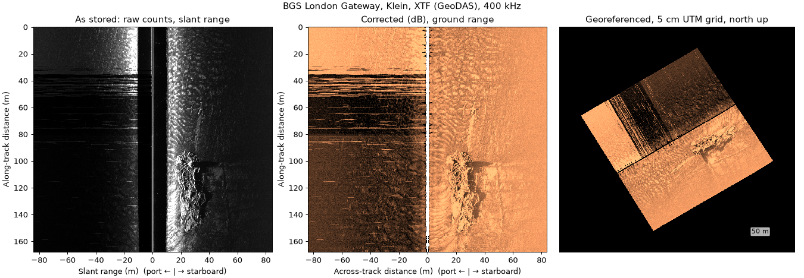
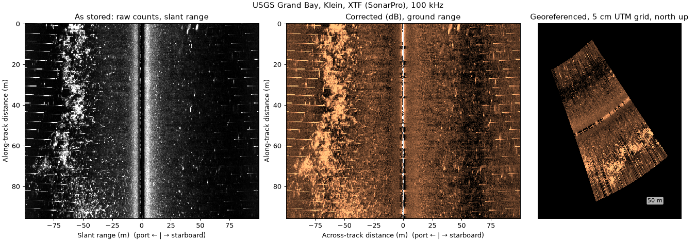
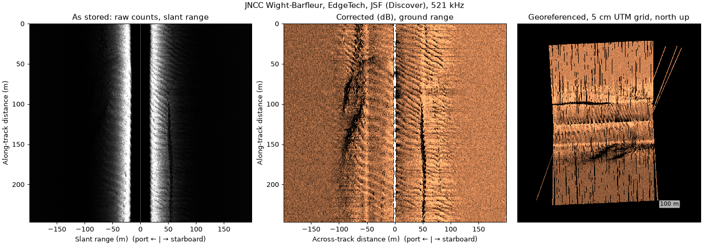
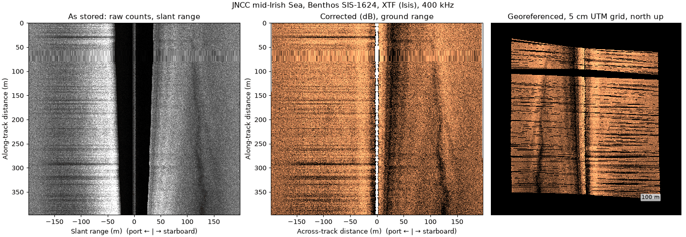
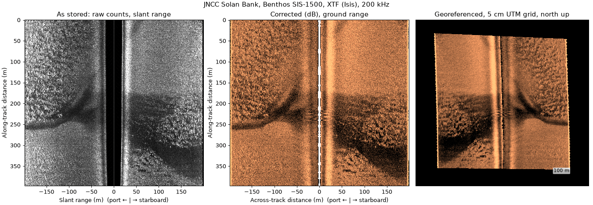
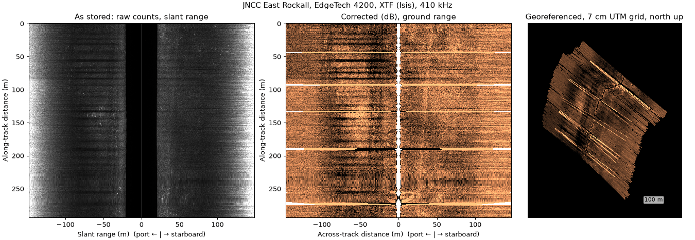
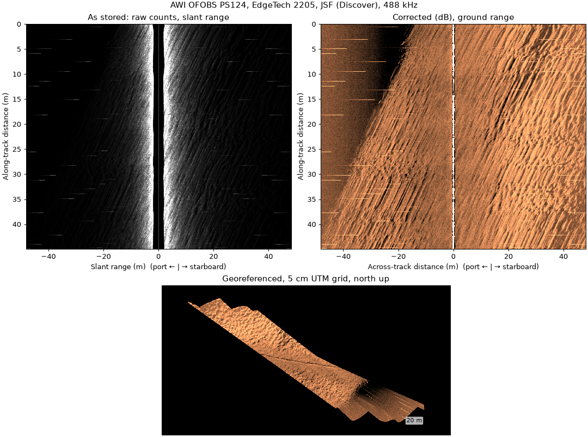
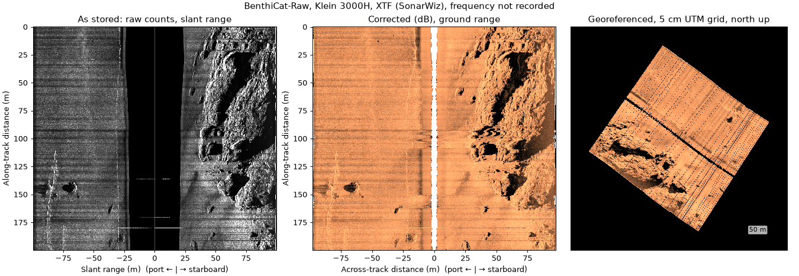

# Public datasets

A running list of openly published sidescan datasets and whether
sidescanpy reads them. [Example data](example_data.md) lists the
individual files that `sidescanpy.datasets.fetch()` downloads for the
examples and tests; this page lists whole archives, including ones
nothing in sidescanpy downloads yet.

Status:

- **reads**: converted and corrected with the default chain below; the
  figure shows the result.
- **reads with caveats**: reads, but the archive leaves something out
  or records it oddly; the notes say what.
- **not yet tried**: raw files in a format sidescanpy reads, not yet
  opened.
- **format not supported**: raw files in a format sidescanpy does not
  read, or images only.

Licences, sizes and file lists come from each landing page when it was
checked; confirm them there before use. Data is not re-hosted here: link
to the archive and cite it.

## Summary

| Dataset | Format (writer) | Sonar | Licence | Status |
|---|---|---|---|---|
| [BGS London Gateway](#bgs-london-gateway) | XTF (GeoDAS, SonarPro) | Klein, 400 kHz | OGL v3 | reads with caveats |
| [USGS Grand Bay](#usgs-grand-bay) | XTF (SonarPro) | Klein 3900 | U.S. public domain | reads |
| [JNCC Wight-Barfleur Reef](#jncc-wight-barfleur-reef) | JSF and XTF (Discover) | EdgeTech, 219 + 521 kHz | OGL v3 | reads |
| [JNCC mid-Irish Sea](#jncc-mid-irish-sea) | XTF (Isis) | Benthos SIS-1624, 100 + 400 kHz | OGL v3 | reads |
| [JNCC Solan Bank](#jncc-solan-bank) | XTF (Isis) | Benthos SIS-1500, 200 kHz | OGL v3 | reads |
| [JNCC East Rockall Bank](#jncc-east-rockall-bank) | XTF (Isis) | EdgeTech 4200, 120 + 410 kHz | OGL v3 | reads with caveats |
| [AWI OFOBS, PS124](#awi-ofobs-ps124) | JSF (Discover) | EdgeTech 2205 | CC BY 4.0 | reads |
| [BenthiCat-Raw](#benthicat-raw) | XTF (SonarWiz) | Klein 3000H | CC BY 4.0 | reads with caveats |
| [NPS Gateway NRA](#not-yet-tried) | JSF (Discover) | EdgeTech 4125, 400 + 900 kHz | U.S. government, none stated | not yet tried |
| [MGDS REMUS 600, FK170825](#not-yet-tried) | JSF | EdgeTech 2205 | CC BY-NC-SA 4.0 | not yet tried |
| [MGDS MBARI Mapping AUV](#not-yet-tried) | JSF, nav separate | EdgeTech 2205 | CC BY-NC-SA 3.0 (check each) | not yet tried |
| [MGDS Sentry, FK171110](#not-yet-tried) | EdgeTech format, probably JSF | EdgeTech 2205 | CC BY-NC-SA 4.0 | not yet tried |
| [MGDS NBP1001](#not-yet-tried) | XTF | EdgeTech, towed | CC BY-NC-SA 3.0 | not yet tried |
| [PANGAEA HE501](#not-yet-tried) | not listed (JSF or XTF) | EdgeTech 4200-MP | CC BY-NC 4.0 | not yet tried |
| [Geoscience Australia GA0346](#not-yet-tried) | XTF | EdgeTech, 120 + 410 kHz, AUV | check | not yet tried |
| [USGS Gulf Islands, DS 671](#not-yet-tried) | XTF (SonarPro) | Klein 3900 | U.S. public domain | not yet tried |
| [AURORA, Autosub 6000](#not-yet-tried) | XTF | not named | open access, IEEE login | not yet tried |
| [NOAA NOS hydrographic surveys](#not-yet-tried) | mosaics + BAG online; raw on request | various | U.S. public domain | not yet tried |
| [NOAA OCM Hudson River](#format-not-supported) | XTF converted from HSX | GeoSwath (interferometric) | U.S. government | not yet tried |
| [Humminbird, Lowrance](#format-not-supported) | DAT/SON/IDX, SL2/SL3 | recreational | various | format not supported |
| [ML image datasets](#image-datasets) | PNG/JPG + labels | various | various | format not supported |

## Sample outputs

Each dataset below gets the same three panels, all over the same stretch
of pings, made by one script,
[`docs/_scripts/public_datasets_figures.py`](https://github.com/rshomberg-research/sidescanpy/blob/main/docs/_scripts/public_datasets_figures.py)
(`--only <name>` remakes one):

- **As stored:** the samples exactly as the file holds them (units
  inferred by {func}`~sidescanpy.analysis.characterize.infer_units`),
  against slant range, linear 2–98 % stretch.
- **Corrected:** the same pings after the library chain: navigation
  smoothing, altitude from bottom track, TVG, flat-seabed slant to
  ground range, and a range correction fitted on the line. dB, against
  across-track ground range.
- **Georeferenced:** the same pings gridded on UTM, north up, at the
  finest useful cell ({func}`~sidescanpy.grids.recommend_resolution`:
  half the finer native spacing, at least 5 cm).

The stretch is picked to show something: centred on a catalogued target
where the record has one, otherwise the most textured straight stretch
with no navigation jumps. The line under each figure lists the exact
corrections and parameters, read from the processing history. Nothing
is tuned per dataset, so the panels show what the default chain gives;
the [examples](examples/index.rst) tune the chain for several of them.

### BGS London Gateway



```{include} assets/datasets/bgs_london_gateway_caption.md
```

- **Provider:** British Geological Survey, National Geoscience Data
  Centre, item 140325,
  <https://webapps.bgs.ac.uk/services/ngdc/accessions/index.html#item140325>.
  Acquired by the Port of London Authority and Wessex Archaeology.
- **Licence:** Open Government Licence v3.0; "Contains data supplied by
  UKRI."
- **Sonar, format:** Klein (a Klein 3000 in 2008), 400 kHz, 50 or 75 m
  range; XTF written
  by GeoDAS (2007) and KleinXlt/SonarPro (2008).
- **Size, area:** 804 MB of 2007 wreck lines (83 XTF over 13 wrecks)
  and 77 MB of 2008 lines (7 XTF over one wreck); the accession also
  holds 2002 and 2011 surveys. Thames Estuary, UK.
- **Notable:** repeated passes over named wrecks, with the catalogued
  wreck positions in the record (`datasets.BGS_LONDON_GATEWAY_WRECKS`).
- **sidescanpy:** reads with caveats. The 2007 lines store UTM 31N
  without saying so (`nav_crs="EPSG:32631"`), record no heading, and
  carry the recorder's TVG; positions jump 1 to 3 m at each GPS fix.
  Details in [Example data](example_data.md).
- **Figure:** `bgs_london_gateway_dynamo_78.xtf`.

### USGS Grand Bay



```{include} assets/datasets/usgs_grand_bay_caption.md
```

- **Provider:** U.S. Geological Survey data release,
  [doi:10.5066/P9374DKQ](https://doi.org/10.5066/P9374DKQ).
- **Licence:** U.S. public domain.
- **Sonar, format:** Klein 3900 (the file header says Klein 3000), pole
  mounted; XTF written by KleinXlt / SonarPro.
- **Size, area:** 9.8 GB XTF zip, plus a 578 MB zip of CleanSweep
  mosaics (0.30 m). Grand Bay, Mississippi and Alabama, USA; shallow
  estuary.
- **Notable:** a published mosaic of the same lines, for comparison
  ([Four published chains](examples/plot_four_published_chains.rst)).
- **sidescanpy:** reads.
- **Figure:** `usgs_grand_bay_150602205800.xtf`, a short line.
- **Cite:** Locker, S.D., Forde, A.S., and Smith, C.G., 2018, *Subbottom
  and Sidescan Sonar Data Acquired in 2015 From Grand Bay, Mississippi
  and Alabama*: U.S. Geological Survey data release,
  <https://doi.org/10.5066/P9374DKQ>.

### JNCC Wight-Barfleur Reef



```{include} assets/datasets/jncc_wight_barfleur_caption.md
```

- **Provider:** Joint Nature Conservation Committee, *Raw side scan sonar
  data from Wight-Barfleur Reef SCI* (CEND 03/13, 2013),
  <https://www.data.gov.uk/dataset/5298a3dd-af03-4509-b806-ab9f884816ae>.
- **Licence:** Open Government Licence v3.0.
- **Sonar, format:** EdgeTech, 219 + 521 kHz; JSF and the same pings as
  XTF, both written by Discover.
- **Size, area:** 57 GB zip. English Channel, UK.
- **Notable:** the same pings in two formats, which cross-checks the JSF
  and XTF readers; no recorded altitude.
- **sidescanpy:** reads (altitude from `bottom_track`).
- **Figure:** `jncc_wight_barfleur_20130321174522.jsf`.

### JNCC mid-Irish Sea



```{include} assets/datasets/jncc_mid_irish_sea_caption.md
```

- **Provider:** JNCC, *Raw sidescan sonar data from Submarine structures
  in the mid-Irish Sea Area of Search* (CEND 11/08, 2008),
  <https://www.data.gov.uk/dataset/4a67eeb2-3dce-40b6-96ca-66cc25eeeada>.
- **Licence:** Open Government Licence v3.0.
- **Sonar, format:** Benthos SIS-1624, 100 + 400 kHz; XTF written by
  Isis 7.0.
- **Size, area:** 7.9 GB zip. Irish Sea, UK.
- **Notable:** records altitude and navigation, so the default chain is
  enough; used in [Getting started](getting_started.md).
- **sidescanpy:** reads.
- **Figure:** `jncc_mid_irish_sea_MIS11_0.xtf`.

### JNCC Solan Bank



```{include} assets/datasets/jncc_solan_bank_caption.md
```

- **Provider:** JNCC, *Raw sidescan sonar data from Solan Bank Area of
  Search* (CEND 11/08, 2008),
  <https://www.data.gov.uk/dataset/5773e015-c014-416c-aa43-a0397a8fd9e9>,
  and *Processed sidescan mosaics from Solan Bank Area of Search*,
  <https://www.data.gov.uk/dataset/6c1e65a9-d45d-443e-b563-f723ac266ac4>.
- **Licence:** Open Government Licence v3.0.
- **Sonar, format:** Benthos SIS-1500 (the cruise metadata says
  SIS-1624), 200 kHz; XTF written by Isis.
- **Size, area:** 7.5 GB raw zip, 1.2 GB of per-line GeoTIFFs (0.5 m).
  North of Scotland, UK.
- **Notable:** an Isis/TritonMap GeoTIFF for each line.
- **sidescanpy:** reads. Positions are the ship's and no layback is
  recorded, so the grid sits along track from the towfish (about 340 m
  on this line).
- **Figure:** `jncc_solan_bank_SB04_10.xtf`.

### JNCC East Rockall Bank



```{include} assets/datasets/jncc_east_rockall_caption.md
```

- **Provider:** JNCC, *Raw side scan data from Anton Dohrn and East
  Rockall Bank* (MV Franklin, 2009),
  <https://www.data.gov.uk/dataset/09203cee-92dd-486b-8838-a525507765fd>,
  and *Processed side scan data from Anton Dohrn and East Rockall Bank*,
  <https://www.data.gov.uk/dataset/efc2ea5f-c376-4904-b7fb-34cdde65744e>.
- **Licence:** Open Government Licence v3.0.
- **Sonar, format:** EdgeTech 4200 (header; other metadata says
  2200-MP), 120 + 410 kHz; XTF written by Isis 7.2.
- **Size, area:** 2.0 GB raw zip (23 lines), 688 MB of per-line
  GeoTIFFs (0.4 m). Rockall Bank, NE Atlantic.
- **Notable:** an Isis/TritonMap GeoTIFF for each line.
- **sidescanpy:** reads with caveats. Navigation is UTM 29N without
  saying so (`nav_crs="EPSG:32629"`). Positions on this line jump by up
  to 30 m between pings in places, which the default chain does not
  remove; the grid shows it.
- **Figure:** `jncc_east_rockall_ER_C1_SS_001_6.xtf`.

### AWI OFOBS, PS124



```{include} assets/datasets/awi_ofobs_ps124_caption.md
```

- **Provider:** PANGAEA,
  [doi:10.1594/PANGAEA.939172](https://doi.org/10.1594/PANGAEA.939172)
  (raw), [doi:10.1594/PANGAEA.939087](https://doi.org/10.1594/PANGAEA.939087)
  (CARIS mosaics), series
  [doi:10.1594/PANGAEA.939322](https://doi.org/10.1594/PANGAEA.939322).
- **Licence:** CC BY 4.0.
- **Sonar, format:** EdgeTech 2205 on the towed OFOBS frame; JSF from
  Discover Bathymetric ("binned").
- **Size, area:** 60 JSF files of about 51 MB for this profile, each on
  its own URL. Southern Weddell Sea, Antarctica, 2021.
- **Notable:** USBL positions, swath bathymetry from the same sonar, and
  a 0.10 m CARIS intensity mosaic.
- **sidescanpy:** reads.
- **Figure:** `awi_ofobs_ps124_20210217004957.jsf`.
- **Cite:** Hehemann, L., Purser, A., Boehringer, L., Werner, E.,
  Wenzhöfer, F. (2021): *Side scan sonar and swath bathymetry collected
  along OFOBS profiles PS124_26-7 during POLARSTERN cruise PS124, binned*.
  PANGAEA, <https://doi.org/10.1594/PANGAEA.939172>.

### BenthiCat-Raw



```{include} assets/datasets/benthicat_caption.md
```

- **Provider:** University of Girona, Harvard Dataverse,
  [doi:10.7910/DVN/UMABNT](https://doi.org/10.7910/DVN/UMABNT); collection
  <https://dataverse.harvard.edu/dataverse/benthicat>.
- **Licence:** CC BY 4.0.
- **Sonar, format:** Klein 3000H towfish; XTF exported by SonarWiz, low
  frequency channels only (`PORTLF`, `STBDLF`), 1024 samples, about
  100 m a side.
- **Size, area:** 370 GB in all. The sidescan is one 43-part 7z of
  about 110 GB (about 4600 XTF, 246 GB unpacked), so every part is needed
  before extracting. Catalan coast, Spain, 2022, 10 to 50 m deep.
- **Notable:** overlapping lines in 22 sectors, R2Sonic 2022 multibeam
  (xyz and 1 m DEMs) over part of the area, per-sector sidescan mosaics,
  habitat polygons and AUV camera recordings. Companion image sets:
  BenthiCat-SSS-CAM ([doi:10.7910/DVN/VZD5S6](https://doi.org/10.7910/DVN/VZD5S6))
  and BenthiCat-SSS Pre-training ([doi:10.7910/DVN/2VCN7Y](https://doi.org/10.7910/DVN/2VCN7Y)).
- **sidescanpy:** reads with caveats. The files record 0 Hz, so the
  default TVG has no absorption term (pass `absorption_db_per_m`), and a
  speed of 0. Positions are in the ship fields and no layback is
  recorded; the release does not say whether they are the towfish's.
  Not registered in `datasets.fetch`: the archive cannot be read one
  file at a time.
- **Figure:** `N02/N02_SS_04_220807105300_xtf-CH12.xtf`.
- **Cite:** Rajani, H. (2026). *BenthiCat - Raw*. Harvard Dataverse, V1.1,
  <https://doi.org/10.7910/DVN/UMABNT>; and Rajani, H., et al. (2025).
  *BenthiCat: An opti-acoustic dataset for advancing benthic
  classification and habitat mapping*. arXiv:2510.04876.

## Not yet tried

Raw data in formats sidescanpy reads, not yet opened.

- **NPS Gateway National Recreation Area, 2014–2015.** EdgeTech 4125,
  400 + 900 kHz, bow mounted, JSF (Discover); Sandy Hook, New Jersey,
  USA. NPS IRMA
  [Profile 2278770](https://irma.nps.gov/DataStore/Reference/Profile/2278770),
  [catalog.data.gov](https://catalog.data.gov/dataset/side-scan-sonar-data-2014-2015-gateway-national-recreation-area).
  No licence stated (U.S. government work).
- **MGDS, REMUS 600, FK170825 (Hawaii, 2017).** EdgeTech 2205 JSF.
  [doi:10.1594/IEDA/324457](https://doi.org/10.1594/IEDA/324457),
  CC BY-NC-SA 4.0.
- **MGDS, MBARI Mapping AUV.** EdgeTech 2205 JSF without merged
  navigation (MB-System format 132), with multibeam from the same
  vehicle in sibling data sets. For example Escanaba Trough 2016
  ([doi:10.26022/IEDA/330304](https://doi.org/10.26022/IEDA/330304)),
  Cascadia 2021 ([doi:10.60521/332830](https://doi.org/10.60521/332830)),
  Beaufort Sea 2022 ([doi:10.60521/331736](https://doi.org/10.60521/331736)).
  CC BY-NC-SA 3.0 for Escanaba Trough; check each. Download through the
  MGDS web interface.
- **MGDS, Sentry, FK171110 (2017).** EdgeTech 2205 on the Sentry AUV,
  "EdgeTech Sidescan format" (probably JSF).
  [doi:10.60521/331116](https://doi.org/10.60521/331116), CC BY-NC-SA 4.0.
- **MGDS, NBP1001 (Larsen Ice Shelf, 2010).** Towed EdgeTech, XTF.
  [doi:10.1594/IEDA/316265](https://doi.org/10.1594/IEDA/316265),
  CC BY-NC-SA 3.0.
- **PANGAEA, R/V Heincke HE501 (German Bight).** EdgeTech 4200-MP.
  [doi:10.1594/PANGAEA.907463](https://doi.org/10.1594/PANGAEA.907463),
  CC BY-NC 4.0. One 36.5 GB tar; the format inside is not listed.
- **Geoscience Australia, Caswell Sub-basin GA0346 (2014).** EdgeTech
  120 + 410 kHz on an AUV, XTF.
  <https://pid.geoscience.gov.au/dataset/ga/84545>; licence to check
  (Geoscience Australia usually releases under CC BY 4.0).
- **USGS Gulf Islands, 10CCT03 (2010), Data Series 671.** Klein 3900,
  XTF (SonarPro); sister releases DS 577 (Petit Bois) and DS 291 (Siesta
  Key). <https://pubs.usgs.gov/ds/671/>. U.S. public domain. Whether each
  release has raw XTF or only mosaics is to check.
- **AURORA, NOC Autosub 6000, JC125 M87 (Haig Fras, 2015).** XTF
  sidescan with multibeam, camera and navigation from the same AUV.
  IEEE DataPort [doi:10.21227/nnms-te61](https://doi.org/10.21227/nnms-te61)
  (about 200 GB; open access, needs a free IEEE account). Cite Bernardi
  et al. (2022), *IJRR* 41(5),
  [doi:10.1177/02783649221078612](https://doi.org/10.1177/02783649221078612).
- **NOAA NOS hydrographic surveys.** Each survey with sidescan has a
  sidescan mosaic GeoTIFF (`SSSAB`) and BAG bathymetry online
  (<https://data.ngdc.noaa.gov/platforms/ocean/nos/coast/>, e.g.
  F00825, H13100). The raw XTF is archived but must be requested from
  NOAA NCEI. U.S. public domain.

## Format not supported

- **NOAA OCM Hudson River backscatter (2009).** GeoSwath interferometric
  data converted HSX to XTF.
  [InPort 47922](https://www.fisheries.noaa.gov/inport/item/47922). XTF
  from an interferometric system; not yet tried.
- **HYPACK HSX.** The second most common format in NOAA NCEI's sidescan
  holdings; not read.
- **Humminbird DAT/SON/IDX** (e.g. USFWS Chena River 2022 on
  data.gov; PING-Mapper reads it) and **Lowrance SL2/SL3** (sonarlight's
  example files). Recreational sonars; not read.

### Image datasets

Labelled images cut from sidescan by each group's own processing, not
raw pings, so there is nothing for a reader to open. Useful to compare
with what [Targets and datasets](datasets.md) exports.

| Dataset | Content | Host, licence |
|---|---|---|
| AI4Shipwrecks (Sethuraman et al., IJRR 2025) | 286 images, 28 wrecks, pixel masks; EdgeTech 2205 on an AUV | University of Michigan Deep Blue |
| SSS for mine detection (Data in Brief 2024) | 1170 images, YOLO labels; Gavia AUV | figshare 24574879, CC BY 4.0 |
| SWDD (2024) | 7904 images, COCO; Klein 3500 on an AUV | Zenodo 13692547, CC BY 4.0 |
| BenthiCat-SSS Pre-training | about 950k 384 × 384 tiles, 36k masks | Harvard Dataverse doi:10.7910/DVN/2VCN7Y |
| SeabedObjects-KLSG / KLSG-II | ships, aircraft, seafloor | GitHub |
| SCTD | ships, aircraft, people | GitHub |

The REMARO [OpenSonarDatasets](https://github.com/remaro-network/OpenSonarDatasets)
list and Gomes et al. (2025), *Sonar Image Datasets: A Comprehensive
Survey* (arXiv:2510.03353), track more.

## Adding a dataset

Open an issue with the landing page, licence, sonar and format. A
dataset whose licence allows it and whose archive can be read one file
at a time can be added to `sidescanpy.datasets` (see
[Example data](example_data.md)). To redo the figures:

```bash
PYTHONPATH="" uv run --all-extras python -I docs/_scripts/public_datasets_figures.py \
    --benthicat /path/to/N01_05_220731124500_xtf-CH12.xtf
```
